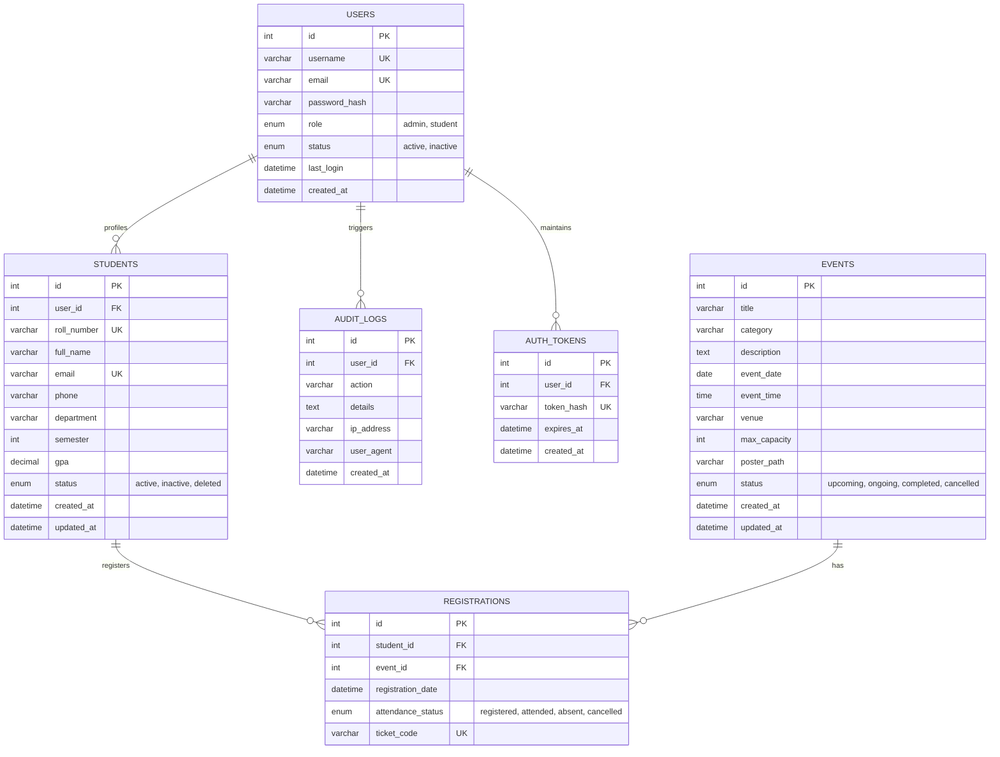

# Practical 1: Entity-Relationship (ER) Architecture
## StudentHub - Advanced Extension Plan
**Course:** ITUE203 Web Development Frameworks

---

## 1. Entity-Relationship Diagram (Mermaid)

---

## 2. Relational Schema & Cardinality Specifications

1. **`USERS` to `STUDENTS` (1 to 0..1):**
   - Each student user record in `USERS` links to exactly one extended profile in `STUDENTS`.
   - Admin users may not have a corresponding `STUDENTS` record.
   - Foreign key constraint: `FOREIGN KEY (user_id) REFERENCES users(id) ON DELETE CASCADE`.

2. **`STUDENTS` to `REGISTRATIONS` (1 to N):**
   - A single student can register for multiple university events.
   - Foreign key constraint: `FOREIGN KEY (student_id) REFERENCES students(id) ON DELETE CASCADE`.

3. **`EVENTS` to `REGISTRATIONS` (1 to N):**
   - A single event can have many student registrations up to `max_capacity`.
   - Unique composite constraint: `UNIQUE KEY uk_student_event (student_id, event_id)` prevents duplicate registrations by the same student.
   - Foreign key constraint: `FOREIGN KEY (event_id) REFERENCES events(id) ON DELETE CASCADE`.

4. **`USERS` to `AUTH_TOKENS` (1 to N):**
   - Stores hashed remember-me tokens for multi-device logins.
   - Foreign key constraint: `FOREIGN KEY (user_id) REFERENCES users(id) ON DELETE CASCADE`.

5. **`USERS` to `AUDIT_LOGS` (1 to N):**
   - Tracks security-relevant actions performed by users and administrators.
   - Foreign key constraint: `FOREIGN KEY (user_id) REFERENCES users(id) ON DELETE SET NULL`.
