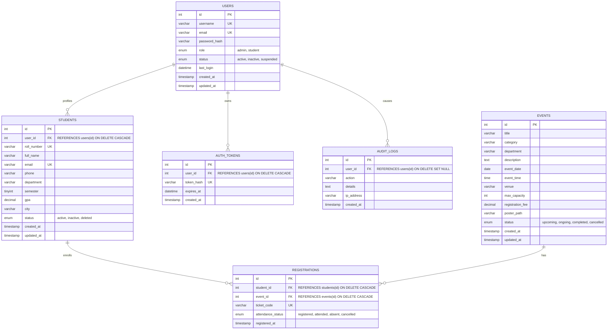

# Practical 8: Database Architecture, ER Model & Normalization Analysis
## StudentHub - Entity-Relationship Design Specification
**Course:** ITUE203 Web Development Frameworks

---

## 1. Entity-Relationship Diagram (Mermaid)

---

## 2. Normalization Analysis (1NF to 3NF)

### First Normal Form (1NF)
- **Requirement:** Each column contains atomic (indivisible) values, and each record is identified by a unique Primary Key.
- **Application in StudentHub:**
  - Phone numbers, email addresses, and event titles are stored as single atomic values (no comma-separated lists of events in the student table).
  - Every table includes an unsigned integer surrogate Primary Key (`id INT UNSIGNED AUTO_INCREMENT PRIMARY KEY`).

### Second Normal Form (2NF)
- **Requirement:** Must be in 1NF, and all non-key attributes must be fully functionally dependent on the entire Primary Key (no partial dependencies).
- **Application in StudentHub:**
  - In `registrations`, attributes like `ticket_code`, `attendance_status`, and `registered_at` depend on the registration instance. Event title and venue remain in `events`, and student name remains in `students`, eliminating partial functional dependency.

### Third Normal Form (3NF)
- **Requirement:** Must be in 2NF, and no non-key attribute is transitively dependent on another non-key attribute (no transitive dependencies: $X \to Y \to Z$).
- **Application in StudentHub:**
  - In `registrations`, we only store foreign keys `student_id` and `event_id`. Storing `student_name` or `event_title` inside `registrations` would introduce transitive dependency (`registration_id` $\to$ `student_id` $\to$ `student_name`), which is completely avoided.
